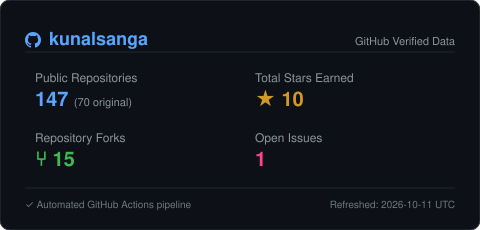
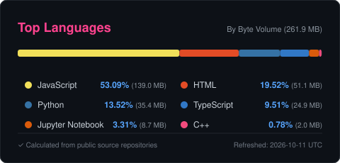

# Hi, I'm Kunal Sanga!

  

<!-- Activity Graph and Stats -->
<h2 align="center">Contribution Graph and Stats</h2>

  

  
  

  
  

<!-- Social Media Badges -->

  
  
  
  
  
  

---

### **About Me**

- **Software Engineer** focused on building scalable applications, backend systems, APIs, and developer tools.
- **AI/ML Engineer** working with LLMs, Generative AI, RAG, Agentic AI, multimodal systems, and computer vision.
- **Researcher** with experience at IIT Roorkee and NIT Jamshedpur, and a published IEEE conference paper on multimodal deep learning.
- Interested in **Continual Learning, Neural Memory, and Quantum Machine Learning**, exploring approaches to more adaptive and efficient intelligent systems.
- Passionate about **open-source development, system design, experimentation, and translating research into practical applications**.

## **Technologies & Tools**

### **Languages**
  
      
    
  ### **Libraries & Frameworks**
  

    
  ### **Databases**
  

   ### **Cloud Services**
  
   
    
  ### **Software Tools**
  

### **Operating Systems**

 

### **Featured Repositories**

*A selection of software engineering systems, intelligent agents, and experimental AI research.*

 

<table width="100%">
  <tr>
    <td width="50%" align="left" valign="top">
      <h4><a href="https://github.com/kunalsanga/Harness-CLI">Harness CLI</a></h4>
      
<code>Developer Tools</code> &nbsp;<code>Autonomous Agents</code>

      
Autonomous AI software-engineering CLI agent that plans, inspects repositories, modifies code, recovers from failures, and delivers verified results.

      
<strong>Stack:</strong> Python, OpenRouter, CLI

    </td>
    <td width="50%" align="left" valign="top">
      <h4><a href="https://github.com/kunalsanga/Adaptive-ai-architecture">Adaptive AI Architecture</a></h4>
      
<code>Continual Learning</code> &nbsp;<code>AI Research</code>

      
Research architecture exploring continual learning paradigms, dynamic neural memory mechanisms, and adaptive systems designed to mitigate catastrophic forgetting.

      
<strong>Stack:</strong> Python, PyTorch, Deep Learning

    </td>
  </tr>
  <tr>
    <td width="50%" align="left" valign="top">
      <h4><a href="https://github.com/kunalsanga/LLM-mental-health-diagnosis">LLM Mental Health Diagnosis</a></h4>
      
<code>AI Research</code> &nbsp;<code>Clinical AI Evaluation</code>

      
Empirical research framework benchmarking LLMs on standardized clinical diagnostic vignettes with multi-provider evaluation pipelines and diagnostic accuracy metrics.

      
<strong>Stack:</strong> Python, Azure OpenAI, Google Gemini, Ollama

    </td>
    <td width="50%" align="left" valign="top">
      <h4><a href="https://github.com/kunalsanga/qmlhep-vqc-architecture-search">QMLHEP VQC Architecture Search</a></h4>
      
<code>Quantum ML</code> &nbsp;<code>Architecture Search</code>

      
Closed-loop, feedback-driven framework coupling Variational Quantum Circuit (VQC) design with LLM-guided architecture search for high energy physics applications.

      
<strong>Stack:</strong> Python, PennyLane, PyTorch, Ollama

    </td>
  </tr>
  <tr>
    <td width="50%" align="left" valign="top">
      <h4><a href="https://github.com/kunalsanga/Jansehat">Jansehat</a></h4>
      
<code>Full-Stack AI</code> &nbsp;<code>Telemedicine</code>

      
Unified AI-driven telemedicine ecosystem connecting patients, healthcare providers, and pharmacists with intelligent triage, prescription workflows, and digital consultations.

      
<strong>Stack:</strong> React 19, JavaScript, Google Gemini AI, Node.js

    </td>
    <td width="50%" align="left" valign="top">
      <h4><a href="https://github.com/kunalsanga/Kepler">Kepler</a></h4>
      
<code>Multimodal AI</code> &nbsp;<code>Local-First Systems</code>

      
Local-first, privacy-focused AI workstation combining real-time streaming LLM conversation with on-device text-to-image and text-to-video generation.

      
<strong>Stack:</strong> Python, Next.js 14, Ollama, ComfyUI, SD Turbo

    </td>
  </tr>
</table>

### **GitHub Stats**

<!-- GitHub Streak Stats -->

  

<!-- 3D GitHub Stats -->

  

---

  

 
